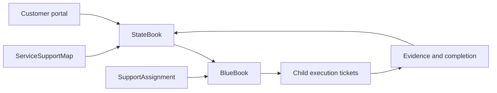

# System architecture

TESSERA extends OTOBO's native ticket, process, package and CMDB APIs with governed orchestration and portal workspaces.

| Authority | Responsibility |
| --- | --- |
| ServiceSupportMap | Governance applicability |
| StateBook | Lifecycle choreography |
| BlueBook | Execution levels/chapters |
| SupportAssignment | Operational scope and assignment |
| Parent ticket | Governance ledger/snapshots |
| Child tickets | Execution evidence |
| Navis | Network evidence and recommendation drafts |
| AWX | Authorized discovery/execution jobs |

Governance snapshots are immutable once orchestration starts. Do not replace this with static queues, hardcoded approval routing or mutable live-Book reevaluation.

CustomerTicketZoom is the authorized runtime surface. Major announcements use a separate limited read-only projection. Dedicated risk assessment uses existing ZRM fields and explicit rendering rather than the generic Set renderer.

See [runtime](runtime-contract.md), [data](data-model.md), [permissions](permissions.md), and [network orchestration](../integrations/navis.md). Older detailed architecture is reference material; latest package behavior wins.

