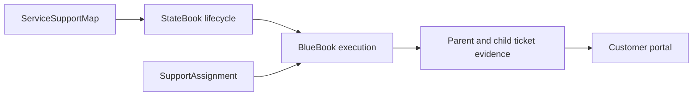

# TESSERA

TESSERA extends OTOBO with governed service requests, lifecycle orchestration, CMDB entitlement and portal workspaces. Books define governance truth, processes orchestrate runtime, and tickets retain execution evidence.

Start with the [documentation hub](docs/README.md), [architecture](docs/architecture/overview.md), [deployment](docs/operations/deployment.md), or [offline AI ScriptEngine authoring](docs/scriptengine/README.md).

## Runtime model

Parent tickets are governance ledgers; children are execution ledgers. Governance snapshots are immutable once orchestration starts. Requester Hold/Resume changes execution state without moving Book position.

## Capabilities

- Customer Workplace, scoped search, request actions, dedicated risk assessment and asset views.
- ContractEntitlement/SupportAssignment boundaries for CI discovery and full detail.
- StateBook/BlueBook orchestration with typed ScriptEngine policies and role resolution.
- Protected Change decisions and approved portal-wide Major announcements.
- Utilities catalogue, uploaded icons, direct Workplace shortcuts and authorized launch.
- Navis default/Application tracing with a stable Application Navis label, AWX handoff/callback, NetXMS and configured external services.

## Request notifications and watchers

Requesters can choose how much email they want for each ticket. Their account preference supplies the starting policy, and the **…** menu on **Create a new Ticket** lets them change it for that request. This gives people a way to follow routine work with fewer emails and keep closer track of a critical request.

| Policy | Events eligible for email |
| --- | --- |
| **Standard** (default) | Request raised and requester-visible status changes. A status update can include the latest customer-visible article. |
| **Minimal** | Request raised and entry into an OTOBO closed state, with the actual closure outcome. |
| **Exclusive** | Standard events plus each new customer-visible article on the master ticket, including public updates written back by the system. |
| **None** | Follow the request in Workplace without email. |

The same **…** menu lets requesters add active portal users from their organization when raising their own request. Invited users see the master ticket in **Workplace → Watched tickets** and can read its public updates. **Watch ticket** and **Unwatch ticket** control the user's email subscription separately from their read access. Task actions, internal articles, child tickets, and asset permissions retain their own access checks.

In **Admin → Email Templates**, administrators can edit HTML templates, build TESSERA scriptlets, apply a shared helpdesk theme, and preview a message with sample data or an authorized ticket. **Test notification policies** shows which built-in events are eligible and which article would be included. Both checks run without SMTP. The OTOBO mail queue adapter is packaged. Automatic ticket-event delivery, duplicate-send prevention, and administrator-created policies are pending.

### BlueBook activity notifications

Starting in TESSERA-Base 0.1.29, each BlueBook activity has configurable **Pre email template**, **Post email template**, and **Escalation policy** settings. Pre is for child ticket creation. Post is for the recorded outcome. The saved default templates are available in **Admin → Email Templates**.

The default escalation policy checks for an open, unclaimed activity. It flags the Secondary role after 3 active days and the Escalation role after 5, within the activity's SupportProfile. Time spent On Hold is excluded from both thresholds. Resuming keeps the active time accrued before the hold.

Use **Admin → Email Templates → Test BlueBook notifications** to try the rules without SMTP. The update-triggered GenericAgent logs eligibility in dry-run mode, and the hourly sweep ships disabled. Live activity email still needs SupportAssignment recipient resolution and duplicate-send protection.

## Build authority

The latest `Kernel/Package/GovernanceDB/TESSERA-Base.sopm` and generated OPM are package authority. Root source and old overlays can contain work in progress. Do not build production releases from a dirty tree or apply historical overlays over an installed package.

The next prepared upgrade is **Base 0.1.9**; see [release status](docs/releases/README.md). Package preparation, publication and actual live acceptance are distinct. GovernanceDB's PackageMerge version is separate from Base's version.

| Path | Purpose |
| --- | --- |
| Kernel/Package | SOPM, package mirrors and immutable OPM releases |
| Kernel and var | Runtime sources; verify package membership before shipping |
| container/ubuntu2604 | Version-detecting build and controlled deployment kit |
| docs | Architecture, operations, integration and authoring guidance |
| Export | Dated native schemas, not a live site export |
| scripts/test/TESSERA | Runtime, permission and UI fixtures |
| PROJECT_STATUS / PROJECT_NEXT | Completed evidence / pending design and acceptance |
| ZTSMOverlay | Historical portable tooling, not current release authority |

The offline authoring pack includes exact grammar, native exports, package-owned defaults, examples, source and validators. No credentials or live customer records belong in that pack.
