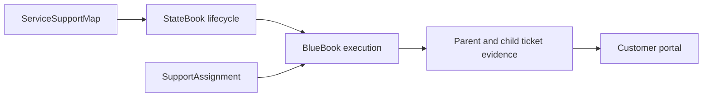

# TESSERA

TESSERA extends OTOBO with governed service requests, lifecycle orchestration, CMDB entitlement and portal workspaces. Books define governance truth, processes orchestrate runtime, and tickets retain execution evidence.

Start with the [documentation hub](docs/README.md), [architecture](docs/architecture/overview.md), [deployment](docs/operations/deployment.md), or [offline AI ScriptEngine authoring](docs/scriptengine/README.md).

## Runtime model

Parent tickets are governance ledgers; children are execution ledgers. Governance snapshots are immutable once orchestration starts. Requester Hold/Resume changes execution state without moving Book position.

## Capabilities

- Customer Workplace, scoped search, request actions, dedicated risk assessment and asset views.
- ContractEntitlement/SupportAssignment boundaries for CI discovery and full detail.
- StateBook/BlueBook orchestration with typed ScriptEngine policies and role resolution.
- Protected Change decisions and approved portal-wide Major announcements.
- Utilities catalogue, uploaded icons, direct Workplace shortcuts and authorized launch.
- Navis default/Application tracing with a stable Application Navis label, AWX handoff/callback, NetXMS and configured external services.

## Build authority

The latest `Kernel/Package/GovernanceDB/TESSERA-Base.sopm` and generated OPM are package authority. Root source and old overlays can contain work in progress. Do not build production releases from a dirty tree or apply historical overlays over an installed package.

The next prepared upgrade is **Base 0.1.5**; see [release status](docs/releases/README.md). Package preparation, publication and actual live acceptance are distinct. GovernanceDB's PackageMerge version is separate from Base's version.

| Path | Purpose |
| --- | --- |
| Kernel/Package | SOPM, package mirrors and immutable OPM releases |
| Kernel and var | Runtime sources; verify package membership before shipping |
| container/ubuntu2604 | Version-detecting build and controlled deployment kit |
| docs | Architecture, operations, integration and authoring guidance |
| Export | Dated native schemas, not a live site export |
| scripts/test/TESSERA | Runtime, permission and UI fixtures |
| PROJECT_STATUS / PROJECT_NEXT | Completed evidence / pending design and acceptance |
| ZTSMOverlay | Historical portable tooling, not current release authority |

The offline authoring pack includes exact grammar, native exports, package-owned defaults, examples, source and validators. No credentials or live customer records belong in that pack.
